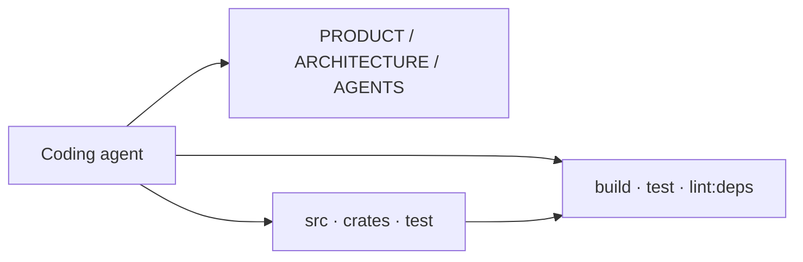
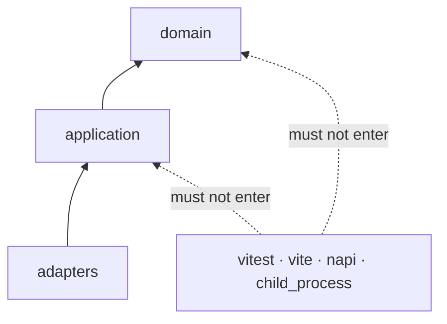
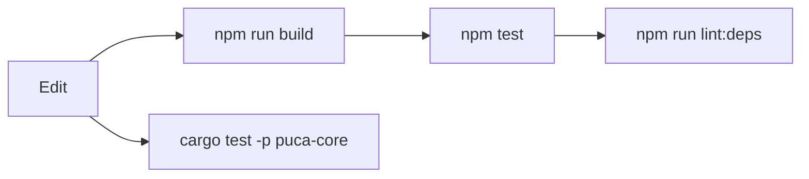
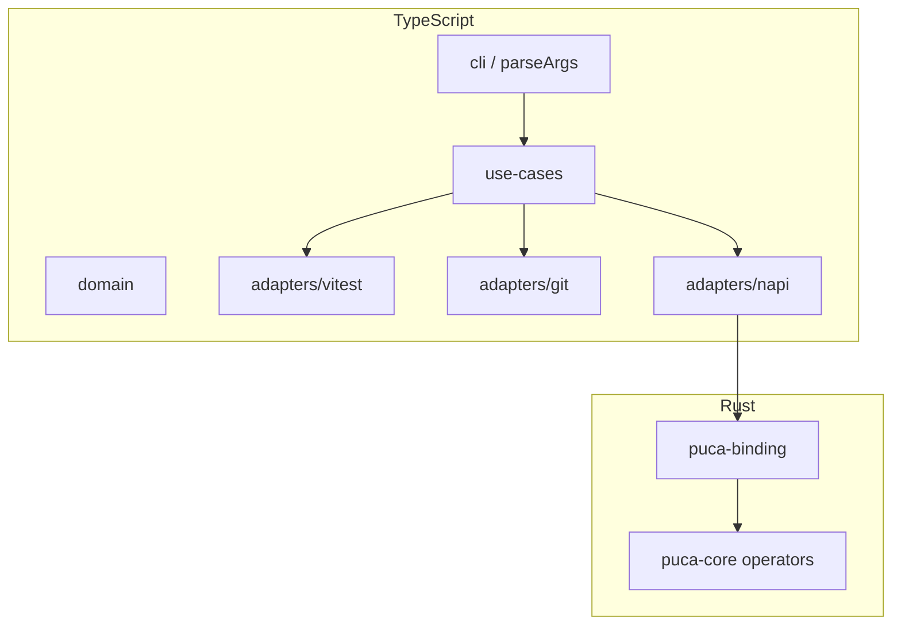
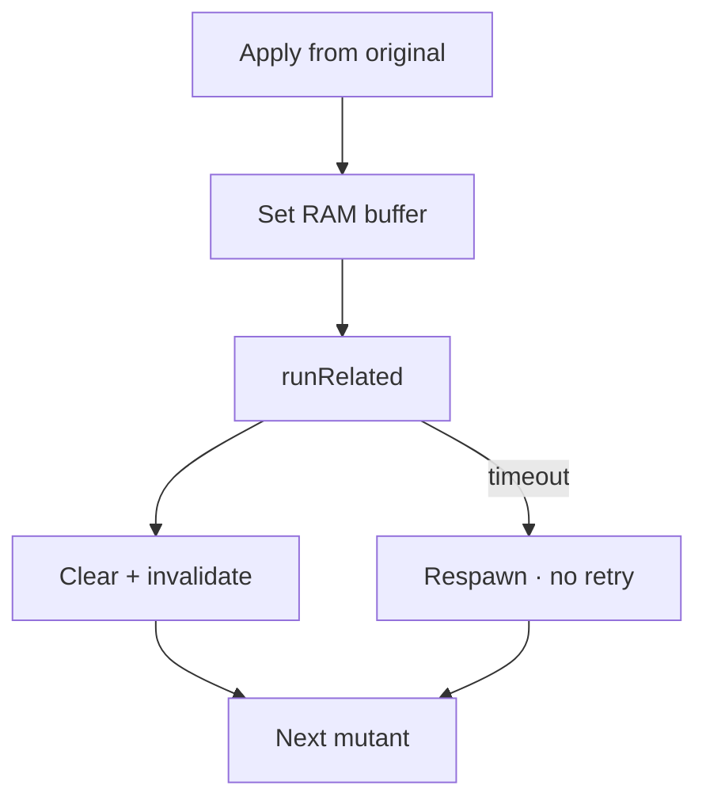
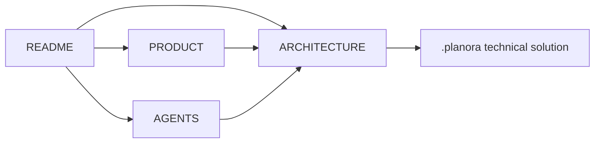

# AGENTS.md — Working on Púca

Guidance for coding agents (and humans) editing this repository. Product intent: [PRODUCT.md](./PRODUCT.md). Structure: [ARCHITECTURE.md](./ARCHITECTURE.md). Normative Phase 1 IDs: `.planora/puca-phase-1-technical-solution.md`.



---

## Non-negotiables

1. **Hexagon stays clean.** `src/domain` and `src/application` must not import `vitest`, `vite`, napi bindings, or `node:child_process`. Verify with `npm run lint:deps`.
2. **Composition root is sacred.** Wire prod vs fakes only in `src/composition/createRuntime.ts`. Do not invent parallel adapter names (`ExecGitAdapter`, `NapiOxcMutator`, `VitestRunnerAdapter`, `SchemaJsonReporter`).
3. **Mutants never touch disk.** Only `--json` may write. RAM plugin + `invalidateFile` after every mutant (R1).
4. **A6 targeting lock** — idle empty git-dirty → exit **0**; empty `--mutate` → **2**; not-a-git without `--mutate` → **2** with the exact stderr string.
5. **Behavioral tests** — name by behavior (`when … / should …`), mock I/O boundaries only, prefer Given/When/Then. Prefer extending `test/*.test.ts` over 1:1 class mirrors.
6. **Do not hand-edit Planora lane status** when Planora MCP is connected — use `move_card` / `update_card` with path `.planora/puca-phase-1-1794671137.planora.md`.



---

## Toolchain

| Need | Command |
| --- | --- |
| Build TS + NAPI | `npm run build` (`tsc -p tsconfig.build.json` + napi) |
| Unit/behavioral + E2E | `npm test` |
| Editor / full typecheck | `npm run typecheck` (`tsconfig.json` includes `src` + `test`) |
| Boundary lint | `npm run lint:deps` |
| Rust mutator | `cargo test -p puca-core` |

- Node `>=20.6`, Rust stable via `rust-toolchain.toml`.
- `@types/node` is already a devDependency. Root `tsconfig.json` is **noEmit** and includes tests; **emit** goes through `tsconfig.build.json` only.
- Sentinel: verify/approve installs before adding npm or crates.io deps when that workflow is active.



---

## Where to change what

| Change | Primary paths |
| --- | --- |
| Domain types / statuses | `src/domain/` |
| Session orchestration / CI exit gates | `src/application/use-cases/RunMutationSessionUseCase.ts`, `src/application/evaluateQualityGates.ts` |
| Ports | `src/application/ports/` (`ReportPort.writeSarif?` additive) |
| CLI flags / exit process | `src/adapters/inbound/cli/`, `src/cli.ts` |
| Git targeting / excludes | `src/adapters/outbound/git/`, `src/domain/excludes.ts` |
| Vitest session / RAM / map | `src/adapters/outbound/vitest/` |
| Reports / File Summary / SARIF | `src/adapters/outbound/report/` (`StdioReport`, `formatFileSummaryTable`, `SarifFile`) |
| Operators / disable / apply / TemplateLiteral skip | `crates/puca-core/src/` (`operators/mod.rs` `visit_template_literal`) |
| NAPI surface | `crates/puca-binding/`, `src/adapters/outbound/napi/` |
| Fixture oracle | `fixtures/loop/`, `test/e2e.loopFixture.test.ts` |



After changing Rust operators or NAPI: `npm run build` before `npm test -- napiMutator` or E2E.

---

## Patterns to prefer

- **Vertical tickets** — one observable outcome; keep Files disjoint when claiming Parallel.
- **Fail closed** — missing Vitest / NAPI / Browser Mode / red baseline → exit 2.
- **Apply from original bytes** every mutant — never from the previous mutant string.
- **Timeout path** — mark Timeout, respawn session, continue to next mutant (no retry of the hung one).
- **Exit priority** — any RuntimeError → 2, else any Survived → 1, else 0.



---

## Patterns to avoid

- Writing mutant sources under `.puca-tmp`, `.stryker-tmp`, or copying fixtures “for isolation”
- Bundling Vitest into the `puca` package (resolve from project `cwd`)
- Mutating test/spec files, configs, `.d.ts`, or `node_modules` / `dist`
- Honoring Stryker disable comments (Púca-only disable lines)
- Expanding into Jest, Browser Mode, CJS, SFC, or `puca.config.ts` without an explicit product decision
- Publishing to the npm registry or adding git `optionalDependencies` on unpublished `puca-<abi>` names (Phase 3.1 ships GitHub Release tarballs only)
- Adding UI layers — terminal contract is enough (UX-001)

---

## Quick verification checklist

Before claiming done on a behavior change:

```bash
npm run build
npm test
npm run lint:deps
# if Rust touched:
cargo test -p puca-core
# if loop / Vitest session touched:
npm test -- e2e.loopFixture
```

Manual fixture:

```bash
cd fixtures/loop
node ../../dist/cli.js --mutate 'src/**/*.ts' --timeout 4000
```

Expect exit **1** on the checked-in oracle (Survived present) unless you changed the fixture.

---

## Docs map

| File | Audience |
| --- | --- |
| [README.md](./README.md) | Humans: install, flags, exits, etymology |
| [PRODUCT.md](./PRODUCT.md) | Product scope and non-goals |
| [ARCHITECTURE.md](./ARCHITECTURE.md) | Ports, pipeline, ADRs |
| This file | Agents editing the tree |
| `.planora/*` | Plan / Build board + technical solution (IDs) |


