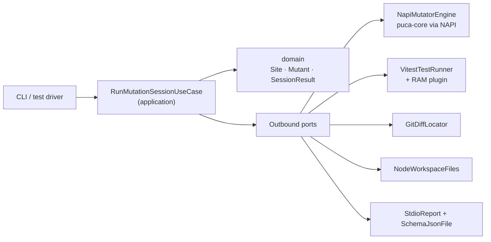
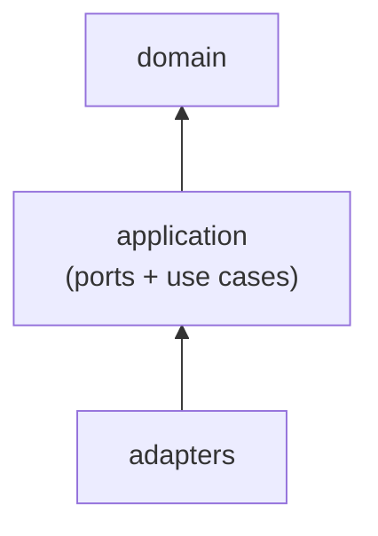
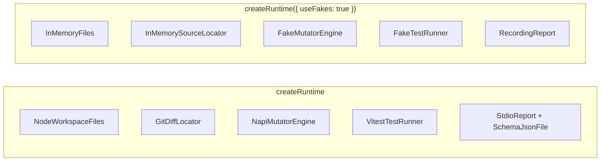
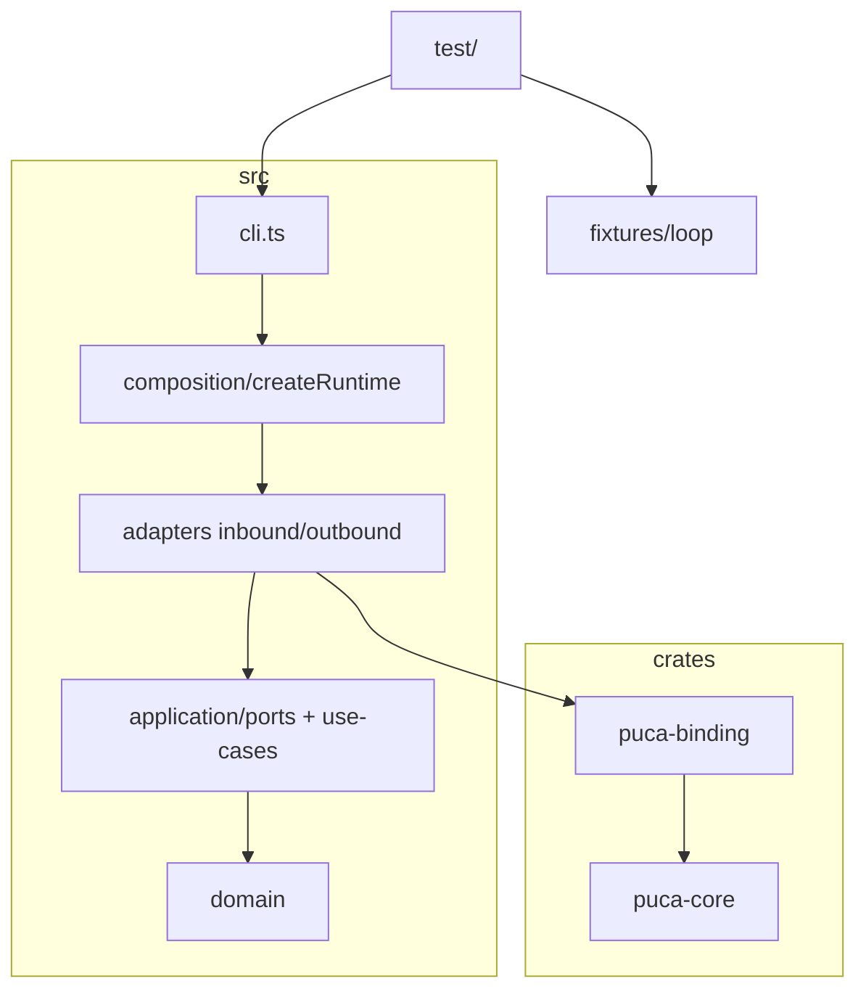
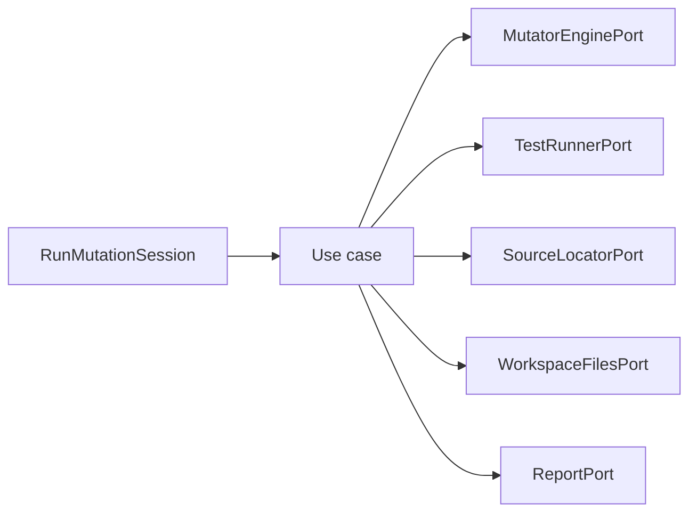
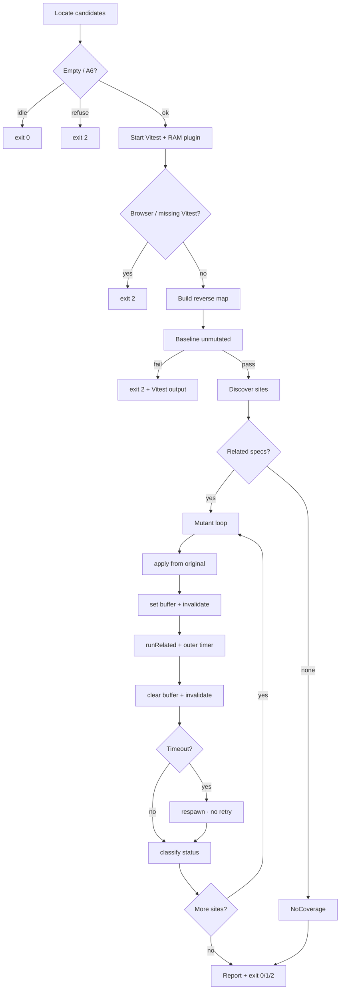
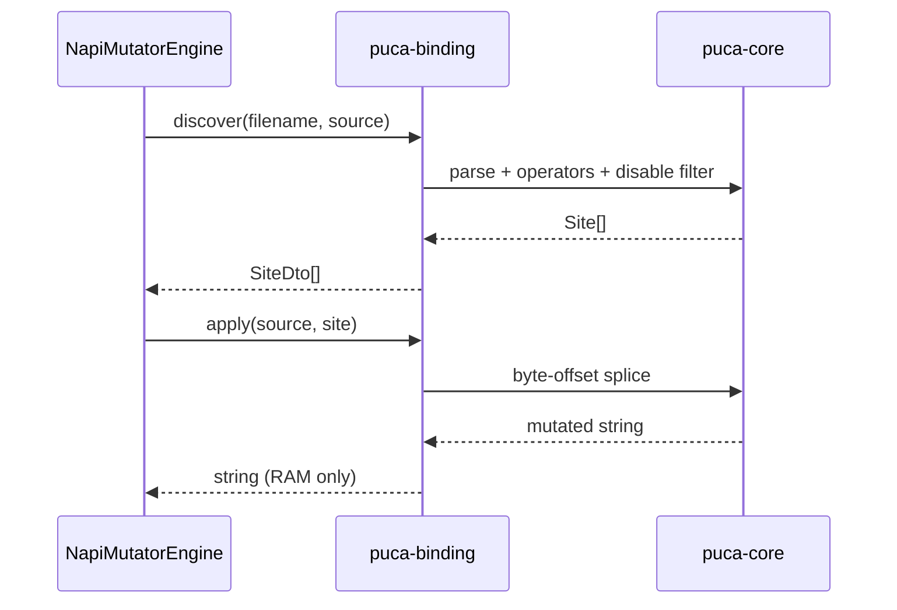
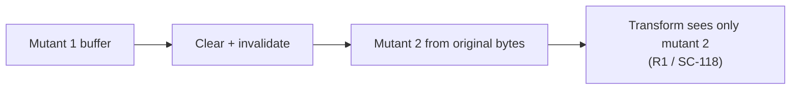
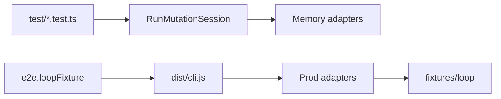

# Púca — Architecture

Phase 1 architecture for the in-memory Vitest mutation loop. Normative detail and REQ/SC/ADR catalogs: `.planora/puca-phase-1-technical-solution.md`.

---

## Big picture

- **TypeScript** owns orchestration (hexagonal).
- **Rust (`puca-core`)** owns parse + site discovery + lazy apply (oxc).
- **napi-rs (`puca-binding`)** exposes `discover` / `apply` to Node.
- **Vitest** is resolved from the **user project** `cwd`, never bundled.

---

## Dependency rule

- `domain` imports nothing from `node:*`, `vitest`, `vite`, napi, or `child_process`.
- `application` stays free of those too (enforced by `npm run lint:deps` / dependency-cruiser).
- `puca-core` knows oxc only — not Vitest or Git.

Cockburn test: `createRuntime({ useFakes: true })` runs `RunMutationSession` with memory adapters only.

---

## Module layout

Composition root is the **only** place that chooses prod vs fake adapters. Do not invent alternate type names (`ExecGitAdapter`, `NapiOxcMutator`, …).

---

## Ports

| Port | Responsibility | Prod | Fake |
| --- | --- | --- | --- |
| `RunMutationSession` | Inbound: run a session | CLI + tests | — |
| `MutatorEnginePort` | `discover` / `apply` | `NapiMutatorEngine` | `FakeMutatorEngine` |
| `TestRunnerPort` | Session, reverse map, baseline, runRelated, respawn (**unexported**) | `VitestTestRunner` | `FakeTestRunner` |
| `SourceLocatorPort` | Candidate files | `GitDiffLocator` | `InMemorySourceLocator` |
| `WorkspaceFilesPort` | `readUtf8` / `exists` / `isUnderCwd` | `NodeWorkspaceFiles` | `InMemoryFiles` |
| `ReportPort` | Terminal (+ optional JSON); File Summary is StdioReport-only (ADR-030), not a port method | `StdioReport` + `SchemaJsonFile` | `RecordingReport` |

Clock / IDs are composition helpers, not ports (A12).

---

## Session pipeline

Site id: `{relpath}:{startOffset}:{mutatorName}:{replacement}`.

---

## Mutator (Rust)

- Parse with oxc; `.ts` vs `.tsx` `SourceType` from extension.
- Sites are **UTF-8 byte offsets** into the original source — discovery does not serialize mutants (ADR-002).
- Operators: arithmetic, equality, boolean, logical, conditional predicates (not `for` headers).
- **ADR-029:** `visit_template_literal` does not walk `${…}` expressions (tagged and untagged); non-template operators including string `+` still discover.
- `apply` splices `replacement` over `[start, end)` — no full AST reprint.
- Disable comments are line-oriented `//` only.

Missing `.node` after clone → exit 2 until `npm run build`.

---

## Architecture decisions (index)

| ID | Decision |
| --- | --- |
| ADR-001 | Hexagonal TS; Rust behind `MutatorEnginePort` |
| ADR-002 | Offset sites; lazy apply |
| ADR-003 | Resolve Vitest from cwd |
| ADR-004 | Prepend RAM plugin via `viteOverrides` |
| ADR-005 | Reverse map from baseline graph; setup/global attach |
| ADR-006 / ADR-020 | Source-build for contributors; GHA packed `puca-<abi>` tarballs via GitHub Releases; **no** npm registry publish |
| ADR-007 | `--json` = mutation-testing-report-schema |
| ADR-008 | Git via `spawn` `shell:false` |
| ADR-009 | Forced session overlay for determinism |
| ADR-010 | `TestRunnerPort` unexported; no `register()` |
| ADR-011 | Exit 0/1/2 + A6 idle vs refuse |
| ADR-012 | Oxc, not Babel/tsc/SWC |
| ADR-029 | Skip all TemplateLiteral `${…}` expressions unconditionally; no CLI flag |
| ADR-030 | File Summary table is StdioReport presentation only; Kill% not domain; ReportPort unchanged |

---

## Risks (load-bearing)

| ID | Risk | Mitigation |
| --- | --- | --- |
| R1 | Mutant leak across sequential applies | Clear buffer + invalidate; maxWorkers 1; SC-118 tests + fixture |
| R2 | Vitest API drift | Resolve project Vitest; fail closed |
| R5 | Hang mutants (`while (true)`) | Outer timeout + cancel/respawn |
| R6 | Missing native addon | Exit 2 until build |

---

## Testing strategy

Behavioral tests under `test/` drive `RunMutationSession` (or focused adapters) with fakes at I/O boundaries. Mock Vitest/Git/NAPI only at those edges — not internal use-case wiring.

E2E: `test/e2e.loopFixture.test.ts` spawns `dist/cli.js` against `fixtures/loop` and checks the oracle, no-sandbox walk, determinism, and leak proof.
