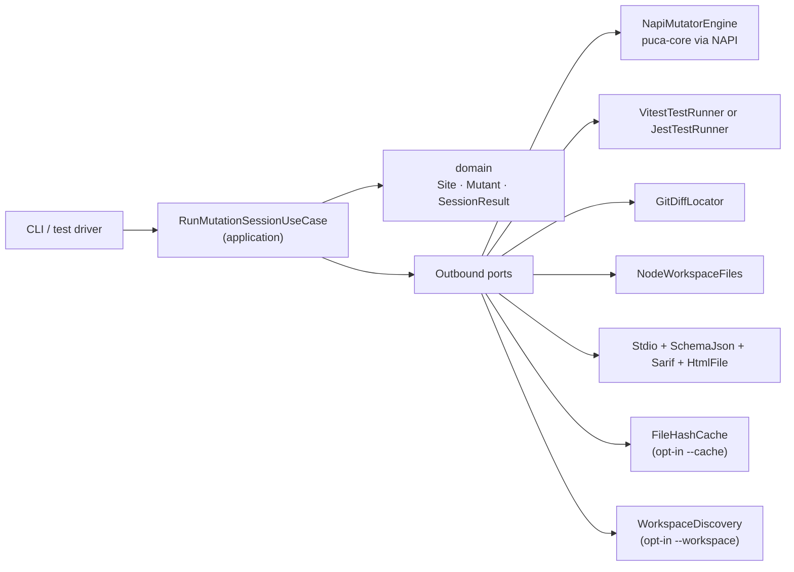
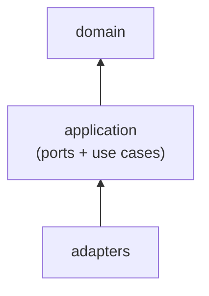
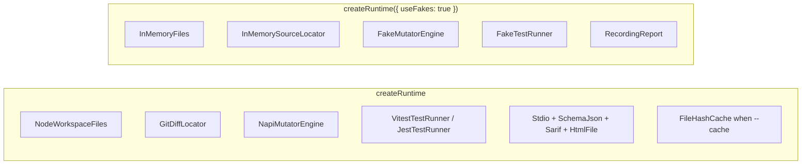
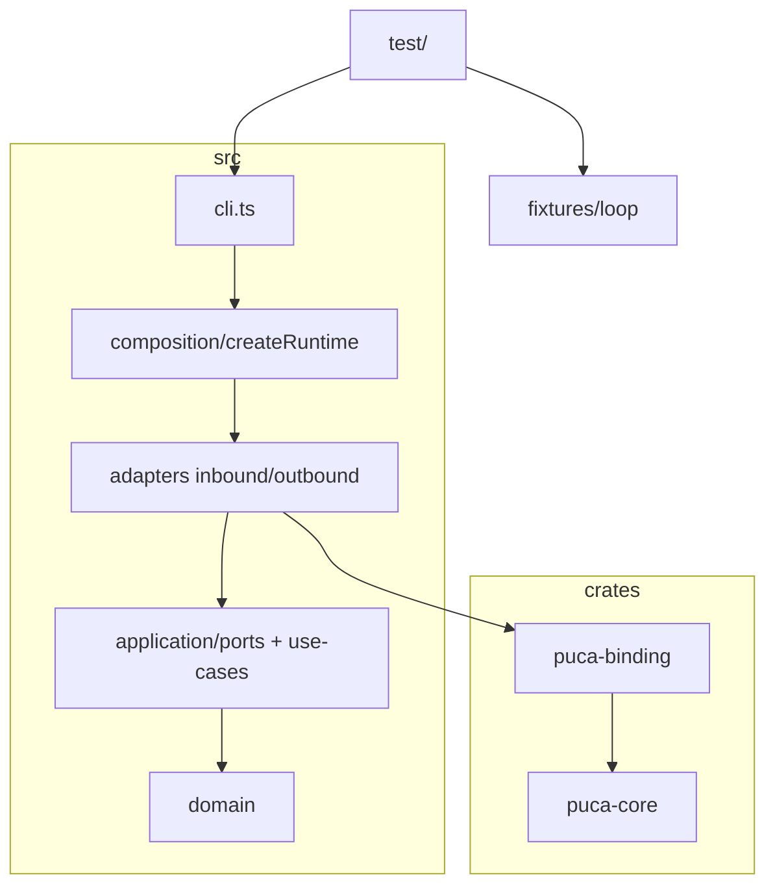
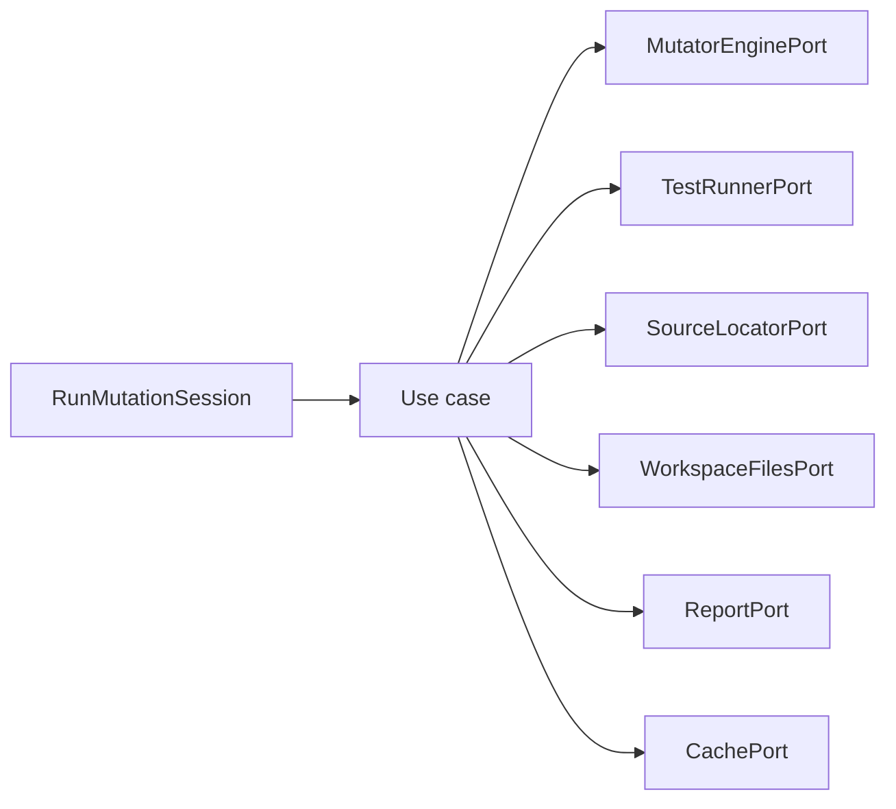
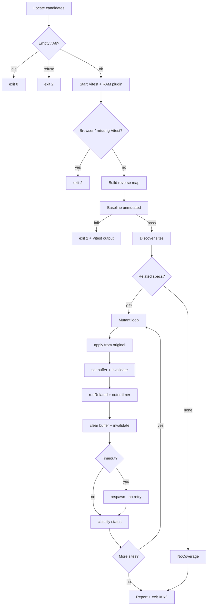
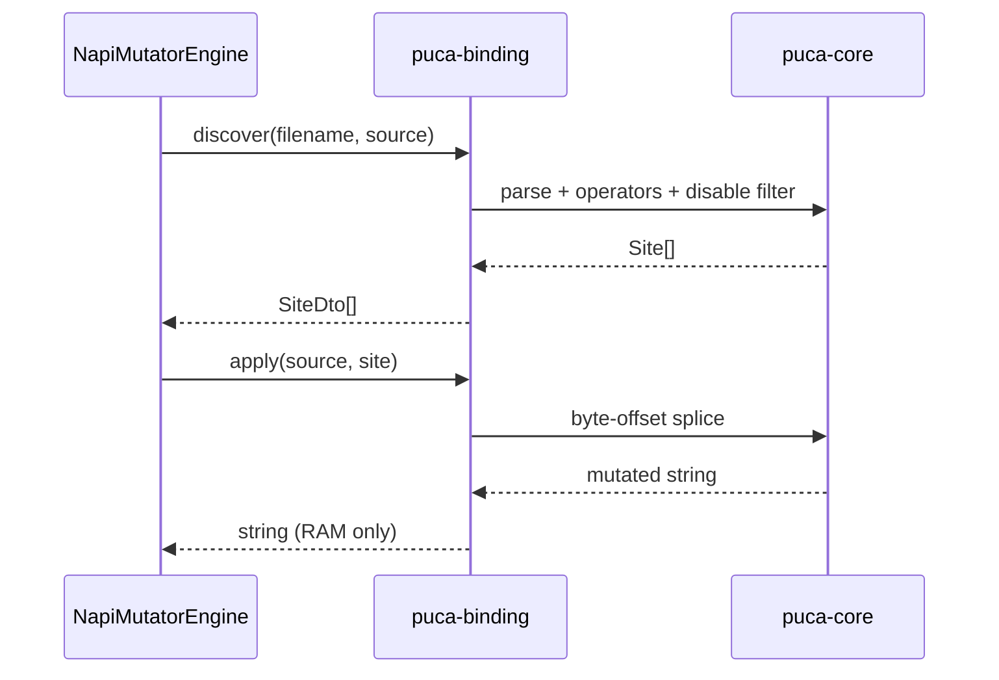
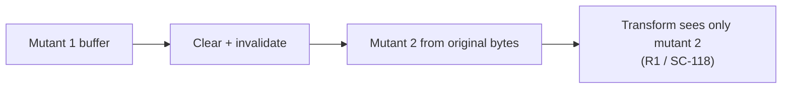
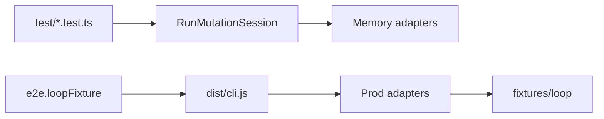

# Púca — Architecture

Phase 1 architecture for the in-memory Vitest mutation loop. Normative detail and REQ/SC/ADR catalogs: `.planora/puca-phase-1-technical-solution.md`.

---

## Big picture



- **TypeScript** owns orchestration (hexagonal).
- **Rust (`puca-core`)** owns parse + site discovery + lazy apply (oxc).
- **napi-rs (`puca-binding`)** exposes `discover` / `apply` to Node.
- **Vitest** is the default runner, resolved from the **user project** `cwd`, never bundled. **Jest** is opt-in via `--runner jest` (single-worker).
- **`--workspace`** wraps sequential per-package sessions (`WorkspaceTargetResolver`); exit is worst-of `2 > 1 > 0`.

---

## Dependency rule



- `domain` imports nothing from `node:*`, `vitest`, `vite`, napi, or `child_process`.
- `application` stays free of those too (enforced by `npm run lint:deps` / dependency-cruiser).
- `puca-core` knows oxc only — not Vitest or Git.

Cockburn test: `createRuntime({ useFakes: true })` runs `RunMutationSession` with memory adapters only.



---

## Module layout



Composition root is the **only** place that chooses prod vs fake adapters. Do not invent alternate type names (`ExecGitAdapter`, `NapiOxcMutator`, …).

---

## Ports

| Port | Responsibility | Prod | Fake |
| --- | --- | --- | --- |
| `RunMutationSession` | Inbound: run a session (or sequential workspace sessions) | CLI + `WorkspaceTargetResolver` | — |
| `MutatorEnginePort` | `discover` / `apply` | `NapiMutatorEngine` | `FakeMutatorEngine` |
| `TestRunnerPort` | Session, reverse map, baseline, runRelated, respawn (**unexported**) | `VitestTestRunner` (default) / `JestTestRunner` (`--runner jest`) | `FakeTestRunner` |
| `SourceLocatorPort` | Candidate files | `GitDiffLocator` | `InMemorySourceLocator` |
| `WorkspaceFilesPort` | `readUtf8` / `exists` / `isUnderCwd` | `NodeWorkspaceFiles` | `InMemoryFiles` |
| `ReportPort` | Terminal (+ optional JSON / SARIF / HTML); File Summary is StdioReport-only (ADR-030); optional `Disabled` column when session suppressions > 0 (ADR-039); `writeSarif?` (ADR-033); `writeHtml?` (ADR-034) | `StdioReport` + `SchemaJsonFile` + `SarifFile` + `HtmlFile` | `RecordingReport` |
| `CachePort` | Opt-in status metadata cache (`--cache`); never mutated source (ADR-035) | `FileHashCache` | memory / no-op |
| `WorkspaceDiscoveryPort` | Resolve package roots for `--workspace` glob (ADR-036) | `NodeWorkspaceDiscovery` | fixture discovery |

Clock / IDs are composition helpers, not ports (A12).



---

## Session pipeline



Site id: `{relpath}:{startOffset}:{mutatorName}:{replacement}`.

---

## Cache schema (ADR-035)

Path: `{cwd}/.puca/cache.json` (per-package under `--workspace`). Opt-in via `--cache` only.

```json
{
  "schemaVersion": 1,
  "engineVersion": "1",
  "entries": {
    "<sha256-key>": {
      "status": "Killed",
      "killedBy": "optional-test-id",
      "schemaVersion": 1
    }
  }
}
```

- **Key** = `sha256(engineVersion ⊕ file ⊕ start ⊕ end ⊕ mutator ⊕ replacement ⊕ sourceContents ⊕ relatedTestContents)`
- **Allowed fields** on entries: `status`, optional `killedBy`, `schemaVersion`
- **Forbidden**: any `mutatedSource` (or other source buffers) — load fail-opens to empty
- Corrupt / truncated / version mismatch → ignore file, full score, rewrite on flush
- Bump `CACHE_SCHEMA_VERSION` or `CACHE_ENGINE_VERSION` in `FileHashCache.ts` to wipe incompatible hits

---

## Module boundaries (enforced)

| Layer | May import | Must not import |
| --- | --- | --- |
| `domain/` | nothing framework | `node:*`, vitest, vite, napi, `child_process` |
| `application/` | `domain/`, ports only | vitest, vite, napi, `child_process`, `node:fs` for cache I/O |
| `adapters/` | ports + Node/Vitest/Jest/NAPI | — |
| `composition/createRuntime.ts` | adapters + use case | invent alternate adapter names |
| `crates/puca-core` | oxc | Vitest / Git / Node |

`npm run lint:deps` cruises `dist/domain` + `dist/application`.

---

## Mutator (Rust)

- Parse with oxc; `.ts` vs `.tsx` `SourceType` from extension.
- Sites are **UTF-8 byte offsets** into the original source — discovery does not serialize mutants (ADR-002).
- Operators: arithmetic, equality, boolean, logical, conditional predicates (not `for` headers).
- **ADR-029:** `visit_template_literal` does not walk `${…}` expressions (tagged and untagged); non-template operators including string `+` still discover.
- `apply` splices `replacement` over `[start, end)` — no full AST reprint.
- Disable comments are line-oriented `//` only.



Missing `.node` after clone → exit 2 until `npm run build`.

---

## Architecture decisions (index)

| ID | Decision |
| --- | --- |
| ADR-001 | Hexagonal TS; Rust behind `MutatorEnginePort` |
| ADR-002 | Offset sites; lazy apply |
| ADR-003 | Resolve Vitest from cwd |
| ADR-004 | Prepend RAM plugin via `viteOverrides` |
| ADR-005 | Reverse map from baseline graph; setup/global attach |
| ADR-006 / ADR-020 | Source-build for contributors; GHA packed `puca-<abi>` tarballs via GitHub Releases; **no** npm registry publish |
| ADR-007 | `--json` = mutation-testing-report-schema |
| ADR-008 | Git via `spawn` `shell:false` |
| ADR-009 | Forced session overlay for determinism |
| ADR-010 | `TestRunnerPort` unexported; no `register()` |
| ADR-011 | Exit 0/1/2 + A6 idle vs refuse |
| ADR-012 | Oxc, not Babel/tsc/SWC |
| ADR-029 | Skip all TemplateLiteral `${…}` expressions unconditionally; no CLI flag |
| ADR-030 | File Summary table is StdioReport presentation only; Kill% not domain; ReportPort unchanged |
| ADR-031 | Opt-in CI flags (`--break-on-score`, `--fail-on-no-coverage`, `--sarif`); default path unchanged |
| ADR-032 | `evaluateQualityGates` + use-case exit authority; Survived never suppressed by score ≥ n |
| ADR-033 | Additive `writeSarif?` + `SarifFile`; Survived-only SARIF 2.1.0; explicit `--sarif <path>` |
| ADR-034 | Native self-contained HTML (`HtmlFile`); ban scoped `@stryker-mutator/*` UI; keep `mutation-testing-report-schema` for `--json` |
| ADR-035 | `CachePort` + `FileHashCache` metadata-only `.puca/cache.json`; opt-in `--cache` |
| ADR-036 | `WorkspaceDiscoveryPort` + sequential package sessions; worst-of exit `2 > 1 > 0` |
| ADR-037 | `JestTestRunner` single-worker; soft-force `workers=1` under `--runner jest` |
| ADR-038 | Phase 3 distribution remains GitHub Releases only; npm registry publish deferred to Phase 4 |
| ADR-039 | Discovery noise suppression: collect→heuristic filter→directive filter; `disabledByDirective` + `skippedByHeuristic` + `warnings`; terminal-only File Summary `Disabled` column; no `oxc_semantic`; no sixth scored status; `--json`/HTML/SARIF unchanged. **ADR-035 remains CachePort** — this ID is noise suppression only. |

---

## Risks (load-bearing)

| ID | Risk | Mitigation |
| --- | --- | --- |
| R1 | Mutant leak across sequential applies | Clear buffer + invalidate; maxWorkers 1; SC-118 tests + fixture |
| R2 | Vitest API drift | Resolve project Vitest; fail closed |
| R5 | Hang mutants (`while (true)`) | Outer timeout + cancel/respawn |
| R6 | Missing native addon | Exit 2 until build |



---

## Testing strategy

Behavioral tests under `test/` drive `RunMutationSession` (or focused adapters) with fakes at I/O boundaries. Mock Vitest/Git/NAPI only at those edges — not internal use-case wiring.



E2E: `test/e2e.loopFixture.test.ts` spawns `dist/cli.js` against `fixtures/loop` and checks the oracle, no-sandbox walk, determinism, and leak proof.
