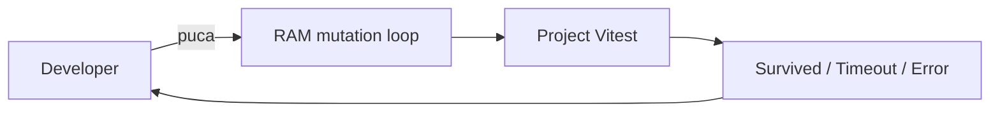
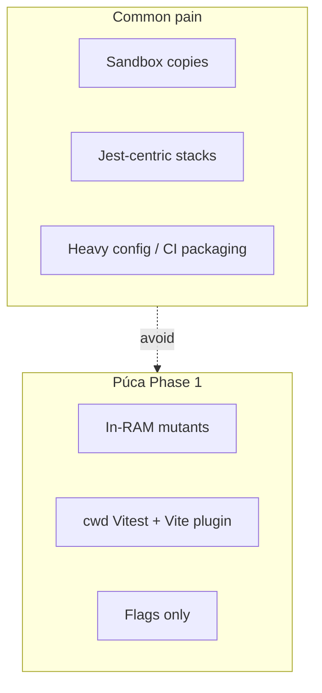
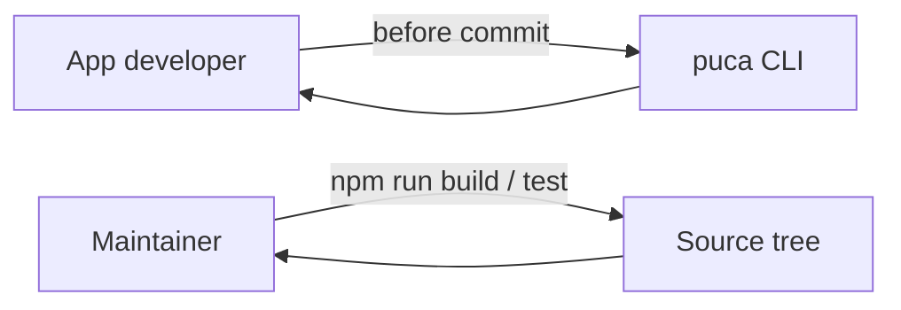
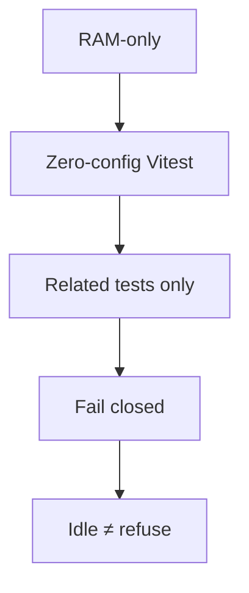
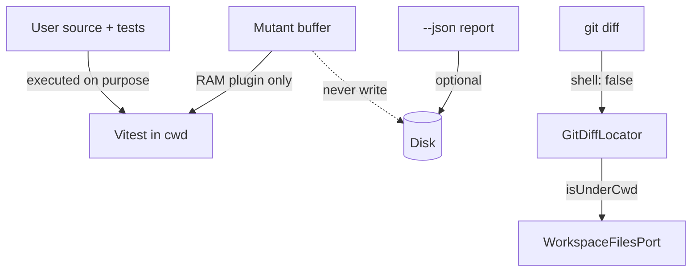

# Púca — Product

**One-liner:** Mutation feedback on the TypeScript you just changed, in seconds, inside your existing Vitest setup — no sandbox copies.

---

## Problem

Application developers on ESM + Vitest repos need a fast answer to “did my tests actually notice this change?” before commit. Existing mutation tools often:

- Copy the whole project into sandboxes (slow, disk-heavy)
- Assume Jest / coverage maps / worker pools
- Require config files and CI-gate packaging

Púca Phase 1 is a **local pre-commit loop**, not a CI platform product.

---

## Users

| User | Job |
| --- | --- |
| App developer | Run `puca` in a Vitest repo on dirty files (or a glob) and see Survived / Timeout / Error |
| Púca maintainer | Build from source with Node ≥ 20.6 and a Rust toolchain; keep hexagon + fixture green |

---

## Product principles

1. **RAM-only mutants** — mutated source never hits disk; `--json` is the only intentional write.
2. **Zero-config Vitest** — resolve `vitest/node` from the project `cwd`; honor aliases, `setupFiles`, `node` / `jsdom` / `happy-dom`.
3. **Related tests only** — reverse import map from the Vitest/Vite graph; empty map → NoCoverage (no run).
4. **Fail closed** — missing Vitest, missing NAPI addon, Browser Mode, red baseline, empty `--mutate`, or not-a-git without `--mutate` → exit 2.
5. **Idle is not refuse** — clean git / nothing eligible to mutate → exit 0 (`No files to mutate`).

---

## What ships (Phase 1)

| Capability | Behavior |
| --- | --- |
| Targeting | Default: git dirty `.ts`/`.tsx` vs HEAD (untracked ignored; stderr skip notice). `--include-untracked` adds untracked files. Override: `--mutate <glob>` (tree walk). Hard excludes never mutate. |
| Mutator | Oxc (Rust) via NAPI: arithmetic, equality, boolean, logical, conditional predicates. Lazy byte-offset apply. |
| Disable | `// puca-disable-next-line`, `// puca-disable` |
| Session | One Vitest keep-alive; Vite RAM plugin; sequential mutants; outer timeout + respawn. `--verbose` lists files, mutators, disable omissions, respawns. |
| Report | Terminal (`file:line:col` + `-`/`+` lines + five buckets); optional mutation-testing-report-schema JSON (`puca/schema/mutation-report.json`) |
| Exits | 0 / 1 / 2 as in [README.md](./README.md) |

Package name: `puca` (unscoped). Binary: `puca`. **Not published** this cycle — consumers build from source (`npm run build`).

---

## Explicit non-goals (Phase 1)

- Jest, `node:test` / `register()` adapters
- V8 coverage maps, warm worker pools, disk mutant cache
- CFG / type-aware pruning, Stryker bake-off claims
- HTML reporter, Browser Mode, CJS, Vue/Svelte/Angular SFC
- Multi-project Vitest monorepos, mutating `.js`/`.mjs`
- Platform `optionalDependencies` prebuilds, `puca.config.ts`
- `@puca/*` npm scope, Windows as a release gate

---

## Success signals (product-facing)

- Fixture `fixtures/loop` classifies Killed / Survived / Timeout / NoCoverage against a checked-in oracle.
- Two cold runs on the same tree produce identical statuses (sorted by site id).
- Workspace walk after a run finds no `.puca-tmp` / `.stryker-tmp` / mutated fixture sources.
- Sequential mutants on one file do not leak (mutant 2’s tests see original code for unrelated operators).

Normative IDs (SC-*, REQ-*, ADR-*) live in `.planora/puca-phase-1-technical-solution.md`.

---

## Operator set (user-visible)

| Family | Examples |
| --- | --- |
| ArithmeticOperator | `+`↔`-`, `*`↔`/`, `%`→`*` (no unary; string `+` still mutated) |
| EqualityOperator | `===`↔`!==`, relational pairs |
| BooleanLiteral | `true`↔`false` |
| LogicalOperator | `&&`↔`\|\|` |
| ConditionalExpression | `if` / `while` / `do-while` / ternary predicates → `true` and `false` (not `for` headers) |

---

## Trust boundary (product)

Púca **intentionally executes** the user’s tests against mutated code in-process via Vitest. That is the product. Controls: no mutant files on disk; git spawn with `shell: false`; hard excludes; plugin swaps only the active mutant path; paths outside `cwd` refused by the workspace files port.

