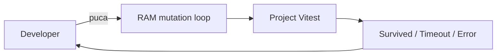
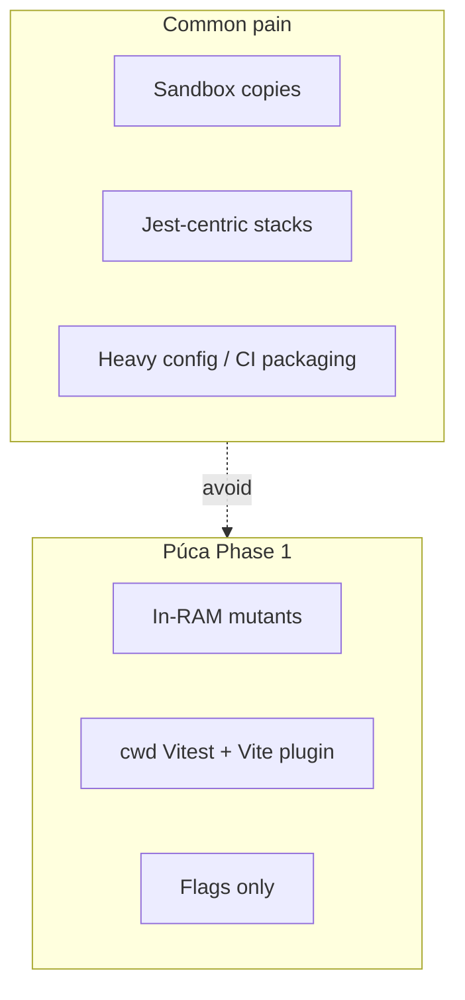
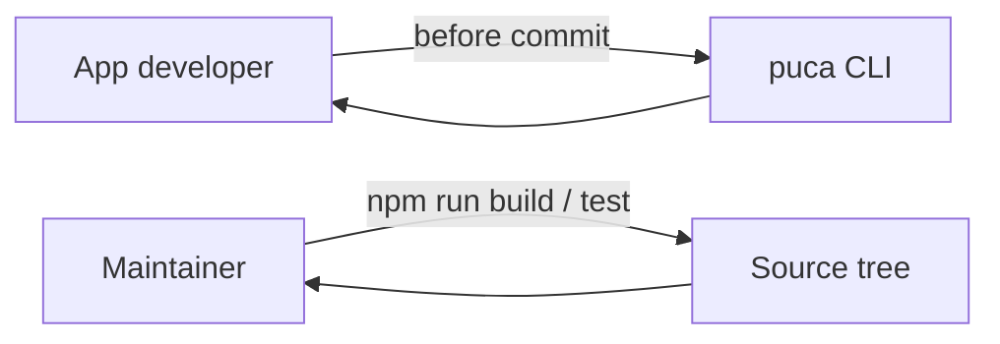
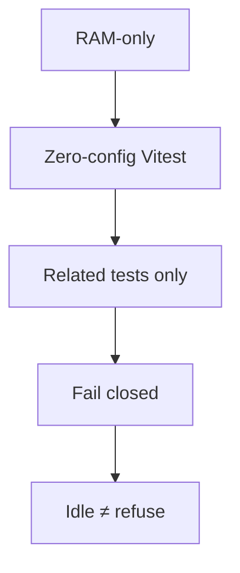
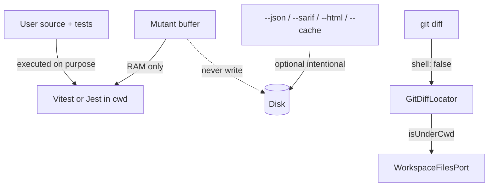

# Púca — Product

**One-liner:** Mutation feedback on the TypeScript you just changed, in seconds, inside your existing Vitest setup — no sandbox copies.

---

## Problem

Application developers on ESM + Vitest repos need a fast answer to “did my tests actually notice this change?” before commit. Existing mutation tools often:

- Copy the whole project into sandboxes (slow, disk-heavy)
- Assume Jest / coverage maps / worker pools
- Require config files and CI-gate packaging

Púca Phase 1 is a **local pre-commit loop**, not a CI platform product.

---

## Users

| User | Job |
| --- | --- |
| App developer | Run `puca` in a Vitest repo on dirty files (or a glob) and see Survived / Timeout / Error |
| Púca maintainer | Build from source with Node ≥ 20.6 and a Rust toolchain; keep hexagon + fixture green |

---

## Product principles

1. **RAM-only mutants** — mutated source never hits disk. Intentional writes are opt-in reports/cache only (`--json`, `--sarif`, `--html`, `--cache`).
2. **Vitest-first, zero-config** — default runner resolves `vitest/node` from the project `cwd`; honor aliases, `setupFiles`, `node` / `jsdom` / `happy-dom`. Opt-in `--runner jest` for single-worker Jest (Phase 3.4).
3. **Related tests only** — reverse import map from the Vitest/Vite graph; empty map → NoCoverage (no run).
4. **Fail closed** — missing Vitest (or missing Jest under `--runner jest`), missing NAPI addon, Browser Mode, red baseline, empty `--mutate`, invalid Phase 3.4 flags, or not-a-git without `--mutate` → exit 2.
5. **Idle is not refuse** — clean git / nothing eligible to mutate → exit 0 (`No files to mutate`).

---

## Feature roadmap (frozen at Phase 3.4)

| Phase | Shipped | Deferred |
| --- | --- | --- |
| **1** | Dirty/glob targeting, Oxc mutator, Vitest RAM loop, terminal + `--json`, exits 0/1/2 | — |
| **2** | `--workers N` fork pool | — |
| **3.1** | GitHub Release `puca` + `puca-<abi>` tarballs | npm registry publish |
| **3.2** | TemplateLiteral skip; File Summary | — |
| **3.3** | `--break-on-score`, `--fail-on-no-coverage`, `--sarif` | — |
| **3.4** (last Phase 3) | `--html`, `--cache`, `--workspace`, `--runner jest` | Jest multi-worker; CDN/Stryker UI HTML |
| **4** | — | npm publish / OIDC / `optionalDependencies` prebuilds |

## What ships (through Phase 3.4)

| Capability | Behavior |
| --- | --- |
| Targeting | Default: git dirty `.ts`/`.tsx` vs HEAD (untracked ignored; stderr skip notice). `--include-untracked` adds untracked files. Override: `--mutate <glob>` (tree walk). Hard excludes never mutate. |
| Mutator | Oxc (Rust) via NAPI: arithmetic, equality, boolean, logical, conditional predicates. Lazy byte-offset apply. Phase 3.2: expressions inside any `TemplateLiteral` (`${…}`, tagged or untagged) are never mutated — no opt-in flag. |
| Disable | `// puca-disable-next-line`, `// puca-disable` |
| Session | One Vitest keep-alive by default (`--workers 1` / omit). Vite RAM plugin; sequential mutants; outer timeout + respawn. `--workers N` (N≥2) opts into a fork pool of isolated keep-alives (Phase 2). `--verbose` lists files, mutators, disable omissions, respawns/recycles. |
| Report | Terminal (`file:line:col` + `-`/`+` lines + five buckets + Phase 3.2 `── File Summary ──`); optional unscoped `mutation-testing-report-schema` JSON (`--json`); Survived-only SARIF (`--sarif`); native offline HTML (`--html`) — **no** `@stryker-mutator/*` |
| Cache (opt-in) | `--cache` writes metadata-only `.puca/cache.json` (status hashes; never mutated source). Off by default. |
| Workspace (opt-in) | `--workspace <glob>` runs matching packages sequentially; process exit is worst-of `2 > 1 > 0`. |
| Runner | Default `vitest`. `--runner jest` uses a single-worker Jest adapter (workers soft-forced to 1). |
| CI gates (opt-in) | `--break-on-score <1..100>`, `--fail-on-no-coverage` — default no-flag `puca` unchanged (ADR-031). |
| Exits | See **Exit priority** below |

### CLI flag interface (complete)

| Flag | Kind | Default |
| --- | --- | --- |
| `--mutate <glob>` | path glob | git dirty `.ts`/`.tsx` |
| `--include-untracked` | switch | off |
| `--timeout <ms>` | int > 0 | `max(testTimeout+2000, 7000)` |
| `--workers <n>` | int ≥ 1 | `1` |
| `--verbose` | switch | off |
| `--json <path>` | path | unset |
| `--break-on-score <1..100>` | int | unset |
| `--fail-on-no-coverage` | switch | off |
| `--sarif <path>` | non-empty path | unset |
| `--html <path>` | non-empty path | unset |
| `--cache` | switch | off |
| `--workspace <glob>` | non-empty glob | unset |
| `--runner vitest\|jest` | enum | `vitest` |

### Exit priority (scored sessions)

1. Pre-score refuse / invalid flags / missing runner / RuntimeError → **2**
2. Else Survived ≥ 1 **or** (score defined and score `< --break-on-score`) **or** (`--fail-on-no-coverage` and NoCoverage ≥ 1) → **1**
3. Else → **0** (idle clean git also **0**)

Score = `round(100 * Killed / (Killed + Survived))`; denom 0 → N/A (score gate does not fail alone). Survived is never suppressed by a passing score. Workspace aggregates worst-of `2 > 1 > 0`.

Package name: `puca` (unscoped). Binary: `puca`. **Not published to npm** through Phase 3 — consumers build from source (`npm run build`) or install **GitHub Release** tarballs (`puca-0.2.0.tgz` + `puca-<abi>-0.2.0.tgz`). npm registry publish is deferred to **Phase 4**.

---

## Explicit non-goals

- `node:test` / `register()` adapters; Jest **multi-worker** pools (Phase 3.4 Jest is single-worker only)
- V8 coverage maps; always-on disk cache; storing mutated source on disk
- CFG / type-aware pruning, Stryker bake-off claims
- Scoped Stryker UI (`@stryker-mutator/*`), CDN HTML assets, or the `mutation-testing-elements` package (HTML is native/self-contained)
- Browser Mode, CJS, Vue/Svelte/Angular SFC
- First-class mutating of `.mjs` / CJS entrypoints (Jest fixtures may discover `.js` under `--runner jest`; Vitest-first product remains TypeScript)
- `--report` family; magic default SARIF path; coupling `--json` thresholds to `--break-on-score`
- `--mutate-template-expressions` (template skip is unconditional in 3.2)
- `puca.config.ts`
- `@puca/*` npm scope, Windows as a release gate
- **npm registry publish** of `puca` or `puca-<abi>`, and git `optionalDependencies` on unpublished platform names (Phase 3 stays GitHub Releases; unlock in Phase 4)

### Phase 3 distribution (not a non-goal)

GHA packs **GitHub Release** tarballs (`puca-0.2.0.tgz` + matching `puca-<abi>-0.2.0.tgz`) so a rust-free host can install the CLI without `rustc`. Contributors still source-build with `npm run build`. Nothing is published to the npm registry through Phase 3 (ADR-038).

---

## Success signals (product-facing)

- Fixture `fixtures/loop` classifies Killed / Survived / Timeout / NoCoverage against a checked-in oracle.
- Two cold runs on the same tree produce identical statuses (sorted by site id).
- Workspace walk after a run finds no `.puca-tmp` / `.stryker-tmp` / mutated fixture sources.
- Sequential mutants on one file do not leak (mutant 2’s tests see original code for unrelated operators).

Normative IDs (SC-*, REQ-*, ADR-*) live in `.planora/puca-phase-1-technical-solution.md`.

---

## Operator set (user-visible)

| Family | Examples |
| --- | --- |
| ArithmeticOperator | `+`↔`-`, `*`↔`/`, `%`→`*` (no unary; string `+` still mutated; **not** inside `` `${…}` ``) |
| EqualityOperator | `===`↔`!==`, relational pairs |
| BooleanLiteral | `true`↔`false` |
| LogicalOperator | `&&`↔`\|\|` |
| ConditionalExpression | `if` / `while` / `do-while` / ternary predicates → `true` and `false` (not `for` headers) |

Template interpolations (tagged and untagged) are skipped unconditionally (ADR-029). File Summary Kill% is terminal presentation only and never changes exit codes (ADR-030).

---

## Trust boundary (product)

Púca **intentionally executes** the user’s tests against mutated code in-process (Vitest by default; Jest under `--runner jest`). That is the product. Controls: no mutant files on disk; git spawn with `shell: false`; hard excludes; plugin/RAM swaps only the active mutant path; paths outside `cwd` refused by the workspace files port; HTML has no CDN fetches; cache stores status metadata only.

