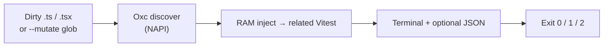
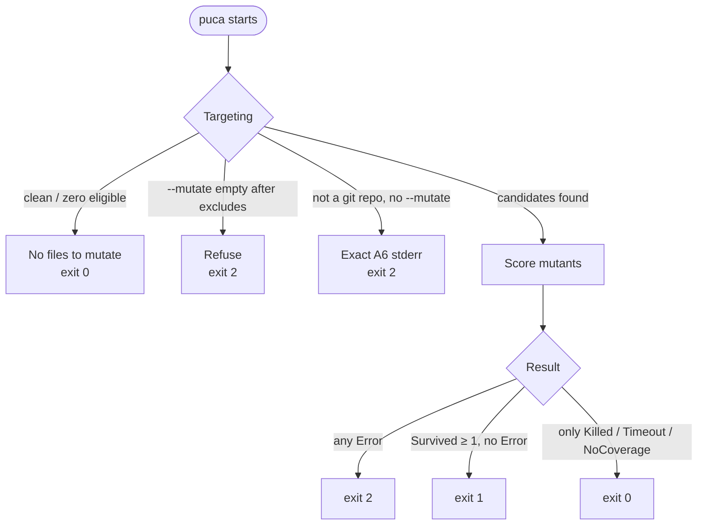
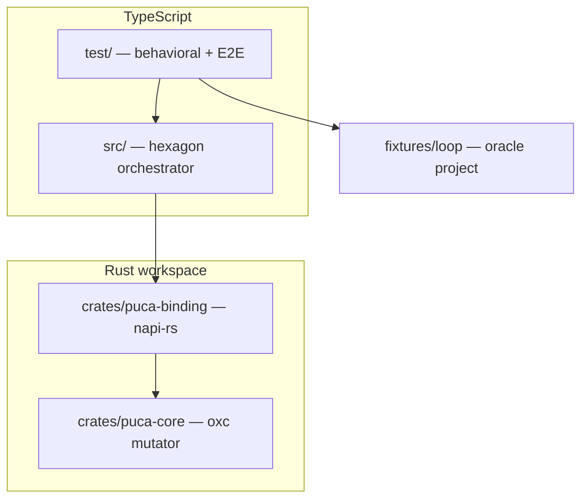

# Púca

Local mutation-testing loop for **TypeScript ESM + Vitest**.

Púca mutates the files you just changed (or an explicit glob), injects each mutant **in RAM** through a Vite plugin, runs only the related Vitest specs on a keep-alive session, and reports what survived — without Stryker-style sandbox copies, Jest, or V8 coverage maps.

Phase 1 is a **source-built** CLI (`puca`). It is not published to npm this cycle.



| Doc | Purpose |
| --- | --- |
| [PRODUCT.md](./PRODUCT.md) | Who it’s for, what ships, what does not |
| [ARCHITECTURE.md](./ARCHITECTURE.md) | Hexagon, ports, Rust/NAPI mutator, session loop |
| [AGENTS.md](./AGENTS.md) | Conventions for coding agents working in this repo |
| [.planora/puca-phase-1-technical-solution.md](./.planora/puca-phase-1-technical-solution.md) | Normative Phase 1 blueprint (REQ/SC/ADR IDs) |

---

## Name & etymology

**Púca** (Irish; plural *púcaí*; anglicised *pooka* / *puck*) is a creature of Irish and wider Celtic/Germanic folklore: a **shapeshifter** and pastoral trickster that can appear as a dark horse, goat, dog, hare, or a human with animal features. Folklore paints it as liminal — helpful or mischievous, associated with night roads, Samhain/Halloween, and sudden changes of form, not with outright killing.

### Word history

- Irish **púca** is generally treated as a **borrowing** into Irish (a *p*-initial word is unlikely as a native Old Irish coinage).
- Closely related forms include Middle English / English **puck**, Old English **pūca** (“goblin”), Welsh **pwca**, Cornish **bucca**, and Scandinavian cognates such as Old Norse **púki** (“mischievous demon / spirit”).
- Pronunciation in Irish is roughly **/ˈpˠuːkə/** (“POO-kuh”). The CLI package and binary use the unaccented ASCII form **`puca`**.

### Why this name for the tool

Mutation testing is deliberate shapeshifting: the tool quietly changes the shape of your source in memory, rides your existing Vitest suite, and leaves you with a clearer sense of which changes your tests still notice — and which ones slipped past. Like the folklore figure, Púca is a **trickster of form**, not a sandbox factory.

---

## Requirements

- **Node** `>= 20.6.0`
- **Rust** stable (pinned in `rust-toolchain.toml`) for `npm run build`
- A target project with **Vitest ≥ 4** installed in that project’s `node_modules` (resolved from `cwd`, never bundled into Púca)
- **Git** on `PATH` when using default dirty-file targeting (not needed with `--mutate`)

---

## Install (from source)

```bash
git clone <this-repo>
cd Púca   # or your checkout path
npm install
npm run build   # tsc → dist/ + napi-rs .node addon
```

The binary entry is `dist/cli.js` (`package.json` `bin.puca`).

---

## Usage

Run from a Vitest TypeScript project (or from `fixtures/loop` after build):

```bash
# Default: mutate git-dirty .ts / .tsx vs HEAD (staged + unstaged; untracked ignored)
puca

# Same default, plus untracked files (still honors .gitignore and hard excludes)
puca --include-untracked

# Explicit glob (ignores git status; walks the tree so untracked files match)
puca --mutate 'src/**/*.ts'

# Outer mutant timeout (ms); default is max(testTimeout + 2000, 7000)
puca --mutate 'src/**/*.ts' --timeout 4000

# Schema JSON report (mutation-testing-report-schema)
puca --mutate 'src/**/*.ts' --json ./mutation-report.json

# Diagnostics: selected files, mutator histogram, disable-comment omissions, Vitest respawns
puca --verbose
```

### Fixture smoke

```bash
npm run build
cd fixtures/loop
node ../../dist/cli.js --mutate 'src/**/*.ts' --timeout 4000
```

### Terminal output

Realtime while scoring (not only a dump at the end):

- Banner: `Scoring N mutants across M files (timeout …ms)…`
- **Survived / Timeout / Error** — printed immediately with index, status, mutator, location, and a `-` / `+` diff:
  ```text
  [12/134] SURVIVED  ArithmeticOperator  src/cart/cartTotal.ts:27:26
  - >
  + >=
  ```
- **Killed / NoCoverage** — compact stderr progress (`[45/134] KILLED … K:40 S:3 …`) so the run stays alive without flooding diffs
- Final `── Summary ──` five-bucket counts
- Default git targeting that skips untracked `.ts` / `.tsx` prints: `ℹ N untracked files skipped…`
- `--verbose` adds selected files, mutator histogram, disable-omit count, and Vitest respawns

### `--json` schema

`--json` writes a [mutation-testing-report-schema](https://www.npmjs.com/package/mutation-testing-report-schema) document. The schema file ships with the package as **`puca/schema/mutation-report.json`** (`schema/mutation-report.json` in the repo). Resolve the absolute path from Node:

```ts
import { mutationReportSchemaPath } from "puca/schemaPath";
```

### Exit codes

| Code | Meaning |
| ---: | --- |
| **0** | Completed with 0 Survived and 0 Error (including idle: nothing to mutate) |
| **1** | Completed with ≥1 Survived |
| **2** | Refuse to score, or ≥1 Error (Error wins even if Survived also exists) |



**A6 targeting lock**

- Clean git / zero eligible dirty files → exit **0**, `No files to mutate`
- `--mutate` matches nothing after hard excludes → exit **2**
- Not a git repo and no `--mutate` → exit **2**, stderr exactly:  
  `Not a git repository. Pass --mutate <glob> to specify files.`

### Hard excludes (never mutated)

`**/*.{test,spec}.{ts,tsx}`, `**/vitest.config.*`, `**/vite.config.*`, `**/*.d.ts`, `**/node_modules/**`, `**/dist/**`

### Disable comments

```ts
// puca-disable-next-line
return a + b;

// puca-disable
// …all later sites in this file omitted
```

Stryker-style disable comments are **ignored**.

---

## Develop

```bash
npm run build       # TypeScript + NAPI addon
npm test            # Vitest behavioral + E2E suite under test/
npm run typecheck   # tsc over src + test (no emit)
npm run lint:deps   # dependency-cruiser: domain/application stay free of vitest/vite/napi/child_process
cargo test -p puca-core
```

### Layout (short)



See [ARCHITECTURE.md](./ARCHITECTURE.md) for ports, composition root, and the mutant loop.

---

## Phase 1 out of scope

Jest · `node:test` register hooks · Browser Mode · CJS · SFC frameworks · multi-project Vitest · platform prebuilds · `puca.config.ts` · HTML UI · `@puca` npm scope · Windows as a hard gate.

---

## License

MIT
